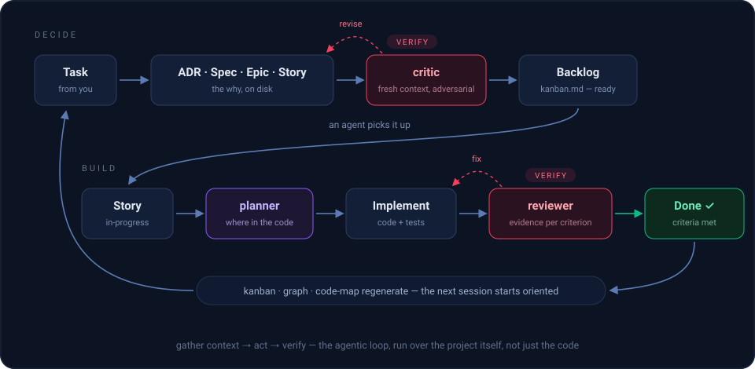
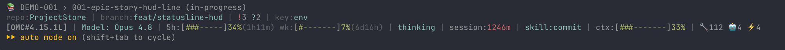
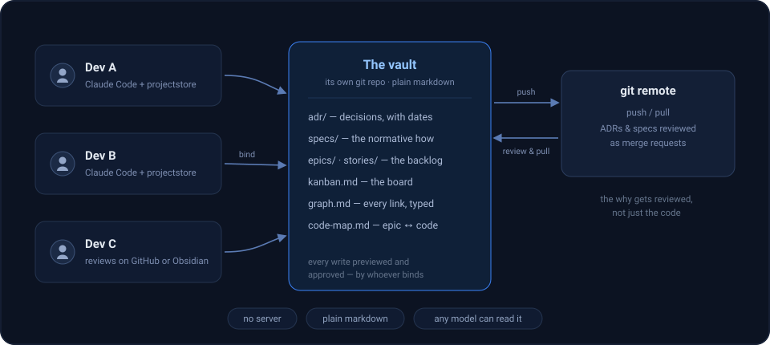

# ProjectStore

> ProjectStore is a method and a framework for building apps and services of any size with AI agents. It keeps the project's record — what was decided, what is in flight, what was checked — as reviewed markdown in git, readable by any agent and anyone with the repo.

[](https://github.com/SmartAndPoint/ProjectStore/releases) [](./LICENSE) [](https://github.com/SmartAndPoint/ProjectStore/stargazers)

A project workflow plugin for [Claude Code](https://claude.com/claude-code) and [OpenAI Codex](https://developers.openai.com/codex/) (experimental). Both are released together at one version, and one command sets a project up for either or both: see [Install](#install).

---

## Two months of agents, and nobody knows why

Agents write code fast. They re-decide settled questions even faster: every fresh session arrives empty, makes its own architectural call, and commits under its own assumptions. Two months later you have noodle code — every strand reviews fine on its own, and each was written under a different theory of the project. Ask *"why is this a queue and not a cron job?"* and nobody can answer. The agent that decided is long gone.

The fix is not a smarter agent. It is a loop with verification in it.

## Where it fits

**Not agent memory. Not a spec pipeline. The project's record.** Three kinds of tools sit next to a coding agent. Each answers a different question.

| Kind of tool | The question it answers | What it keeps | Examples |
|---|---|---|---|
| **Agent memory** | What does this agent recall? | Notes the model keeps from its sessions, for an agent, a user or a machine. | Mem0, Zep, Codex and Claude Code memory |
| **Instruction files** | How should an agent behave here? | Standing rules for an agent, kept in the repository. | `CLAUDE.md`, `AGENTS.md`, rules, steering files |
| **Spec-driven tools** | How do we build this change? | A spec, a plan and tasks for one feature. | Spec Kit, Kiro, OpenSpec, BMAD |
| **ProjectStore** | What has the project decided, what is in flight, and was it checked? | Decisions, specs and work items with a status, a date and links, in git. A person approves each before ProjectStore writes it; a fresh-context critic reviews it by rule. | — |

Keep your agent's memory for you and your machine, and the project in the vault.

Decision logs, validators, session-start orientation and independent review each exist elsewhere. What ProjectStore adds is all of them over one linked record. Tool by tool, with sources: [`docs/alongside.md`](./docs/alongside.md).

## The loop

The thing that makes agentic coding work — the loop Claude Code's own creator keeps pointing at — is *gather context, act, verify, repeat*. ProjectStore runs that loop one level up: over the project, not just the code.



1. **You hand the agent a task.** It opens an artifact before it opens an editor: an ADR if something needs deciding, an epic and stories for the work, a spec when the "how" is non-trivial.
2. **A fresh-context critic attacks the artifact.** Expect *revise* — on this repo it has yet to pass anything on the first try, and that is the point.
3. The fixed artifact lands in the **backlog**; the kanban regenerates itself.
4. An agent picks up a story. A **planner** reads how earlier epics actually landed in the code and says where this change belongs.
5. By rule, a **reviewer** matches the diff against the story's acceptance criteria — per criterion, with evidence — before anything gets called done.
6. **Done.** Board, link graph and code map regenerate. The next session starts oriented instead of guessing.

Mechanisms hold this together, not discipline: an agent that starts coding with no story open gets nudged; an artifact that needs review carries `review_status: pending` until a critic pass is applied, so "not yet reviewed" is a state the tools can read rather than something someone must remember; and a deterministic `doctor` checks the mechanical consistency with zero AI involved. Every *verify* step is a separate fresh-context agent with no stake in the draft it is judging.

We build ProjectStore with ProjectStore. The feature that names your session went through exactly this loop — including a critic pass that killed the design's central claim, and a reviewer pass that caught a bug which would have shipped the feature silently dead for every real user.

## What lands on disk

Say *"let's go with Postgres, not Mongo — we need transactions"*, approve the draft, and a real file lands:

```markdown
---
title: "Use Postgres for primary storage"
status: accepted
date: 2026-07-03
---
## Context
We need ACID transactions for order processing...
## Decision
Postgres 16 as the primary store...
## Alternatives Considered
### MongoDB — rejected because...
```

Six months later, *"why Postgres?"* has an answer with a date and the alternatives you rejected. Stories work the same way — status in frontmatter, board generated from it — and your status line always shows what *this* session is working on:



In Claude Code a band above the prompt goes further (experimental): the session's epic with its goal and how far it is, the story in hand, and the ProjectStore agent at work — `critic · opus 5.5 · reviews «…»` — on the model its own requests name. While it draws, the status line steps aside; `/projectstore:bar off` hides it, `/projectstore:bar status` says why it is not there.

Open the vault in [Obsidian](https://obsidian.md) and you get the graph view and the board for free. Don't use Obsidian? Everything renders on GitHub and in any editor.

Above the epics sit initiatives: an outcome several epics serve, and the decision on it. Create one with `/projectstore:initiative` and a title. Its status records only the decision (`proposed`, `accepted`, `rejected` or `deferred`), with a dated reason in its Outcome section; an epic joins it with `initiative: "<slug>"` in its frontmatter, and doctor reports a link that names no initiative.

## Install

From a terminal in your project:

```
npx projectstore setup
```

Setup finds the coding agents the project uses — Claude Code, Codex or both — and installs ProjectStore for each, with a vault for the project's notes. At a terminal it asks a few questions: which folder is the project, which agents to install for, where the vault lives (an existing folder is bound; a missing or empty one becomes a new vault, with its own git repository and the layout's folders) and whether to show ProjectStore in the status line. Then it prints one plan — every file it writes and every host command, verbatim — and asks once before it writes anything. Restart the agent afterwards; Codex asks you to approve the ProjectStore hooks once.

**What it needs:**

- Node.js 20 or later, always. The plugin's hooks, its MCP server and the status line run as `node` inside the agent session.
- npm, for Codex only: setup fetches the Codex plugin through npm. Claude Code alone needs no npm.
- The agent's own CLI on PATH (`claude`, `codex`), and git for a new vault.
- A terminal outside every Claude Code and Codex session: inside one, the registration waits and the plan says so.
- macOS or Linux. Windows is not verified yet.

Other package runners start setup the same way. Each was observed running it with Claude Code and Codex:

```
bunx projectstore@latest setup
```

```
pnpm dlx projectstore@latest setup
```

```
deno run -A npm:projectstore@latest setup
```

`pnpm dlx` needs pnpm 6.13 or later. Without npm on PATH, a runner sets up Claude Code and refuses Codex, naming npm. The runner only fetches the package: setup copies the plugin into the agents' own directories, so clearing the runner's cache later breaks nothing.

`npx projectstore setup --dry-run` shows the questions and the plan and writes nothing. Without a terminal (a script, CI, an agent's tool) nothing is asked: `--harness <id>` names an agent and is the confirmation, and `--vault <path>` names the vault. `npx projectstore setup --help` lists the rest.

If you prefer a global command:

```
npm install -g projectstore
projectstore setup
```

Behind a registry mirror (often a company's), `npx` runs the newest `projectstore` the mirror knows. That can be a release older than setup, which answers that `setup` is an unknown verb, or no release at all. Name the version, and if that is not enough, the public registry:

```
npm_config_registry=https://registry.npmjs.org npx projectstore@<version> setup
```

npm reads that variable wherever it runs, so the Codex plugin setup fetches comes from the same registry.

### In a Claude Code session

Open Claude Code in your project and say:

> Install the projectstore plugin from https://github.com/SmartAndPoint/ProjectStore and set it up for this project.

Claude adds the git marketplace, installs the plugin, and walks you through binding a vault, scaffolding it and wiring the status line — every step previewed, nothing written without your Yes. Or type it yourself:

```
/plugin marketplace add SmartAndPoint/ProjectStore
/plugin install projectstore@SmartAndPoint
/reload-plugins
/projectstore:bind ~/Documents/my-project-vault
```

One switch worth flipping: Claude Code does **not** auto-update third-party plugins by default — `/plugin` → **Marketplaces** → **SmartAndPoint** → toggle **auto-update** on. If you skip it, `/projectstore:doctor` will remind you later with the exact setting.

Contributors: `git clone` this repo, then run Claude Code from the clone's parent folder:

```
claude --plugin-dir ./ProjectStore
```

<details>
<summary>What setup does for each agent, the low-level verbs, the CLI and MCP</summary>

**Claude Code.** Setup registers the plugin from the npm package [`projectstore`](https://www.npmjs.com/package/projectstore) — one source package carrying every harness's manifest. It writes a small local marketplace of its own under your Claude home, then drives `claude plugin marketplace add` / `plugin install` **at local scope**, so the registration lands in this checkout's `.claude/settings.local.json` and nowhere else. The host CLI and a live session both rewrite the same settings files, so inside a Claude Code session the registration is deferred, and the plan says so: run setup from a terminal outside the session. When the checkout already loads ProjectStore from the git marketplace, setup asks whether to switch this project to the npm install or keep the git marketplace. A switch silences the git-marketplace copy for this checkout only (not globally), so the plugin does not load twice; `uninstall` turns it back on.

**Codex.** The Codex plugin ships in a package of its own; setup fetches it at setup's own version and plans Codex in the same plan as everything else. It stages a stable marketplace under `CODEX_HOME`, drives `codex plugin marketplace add` and `codex plugin add`, then reads the installation back and verifies its version and payload digest. Before it changes anything it asks Codex for that read-back (`codex plugin list --json`), so a Codex too old to answer stops the registration before it changes anything and tells you to upgrade Codex. Codex's plugin registry is user-global; the agents block in `AGENTS.md` stays project-local. Codex is **experimental** until a live session has exercised every surface it installs: [`docs/harnesses.md`](./docs/harnesses.md#codex) says what has been verified and what has not. A project can be worked from both agents: they share the binding in `.projectstore/`, and each keeps its own overlay and session state beside it ([running both over one project](./docs/harnesses.md#running-both-over-one-project)).

**The low-level verbs.** Setup composes verbs that also run on their own. One agent's install, with no questions about the project or the vault:

```
npx projectstore install --harness claude-code   # shows the plan, asks at a terminal, then writes; without a terminal naming the harness is the confirmation — there is no --yes
```

`plan` prints the same plan and writes nothing; `--verbose` adds every row's reasoning; `npx projectstore <verb> --help` lists a verb's options with examples. bun works the same on the packed bin.

Without a session — in CI, or in a shell — the same core answers token-free, with a `--json` envelope on every verb:

```
npx projectstore doctor --json
npx projectstore reconcile --write --only kanban
```

At a terminal the bin's output is coloured; a pipe gets the same layout as plain text. `NO_COLOR=1` turns the colour off, and `PROJECTSTORE_ASCII=1` draws every glyph in ASCII — for a terminal that draws ambiguous-width characters wide (`TERM=dumb` does both).

Reads too — the same facts the agents get over MCP:

```
npx projectstore status --json
npx projectstore search "entry rule" --kind spec
npx projectstore show adr/README.md --section index
npx projectstore graph neighbors epics/PS-CORE/epic.md
npx projectstore codemap --for scripts/lib.mjs
npx projectstore guide spec --section Must
```

The same nine reads are an MCP server. The plugin registers it through its own `.mcp.json`, so a Claude Code session has `status`, `search`, `get_artifact`, `neighbors`, `lineage`, `code_refs`, `orientation`, `doctor` and `guide` as tools with no shell; every tool result is the CLI's `--json` for the same arguments. Elsewhere:

```
npx projectstore mcp --project .
```

Binding, too — naming the vault is the confirmation, and changing it needs `--rebind`. `init` creates a whole vault in one step, with no `mkdir` first: the directory, its git repository, the layout's folders and their README indexes; `scaffold --write` adds the folders to a vault that was bound without them:

```
npx projectstore bind ~/vaults/my-project
npx projectstore init ~/vaults/new-project --language ru
npx projectstore scaffold --write
```

A story moves from the backlog to ToDo, and back, with a reason that goes into its Status log. Bare, it prints the plan; `--write` asks at a terminal and, without one, is the confirmation:

```
npx projectstore move PS-CORE/story-x todo --reason "next up" --write
```

When a person leaves the project, `handover` gives their open stories to someone else, with the reason in each story's Status log. Bare, it prints the plan; `--write` asks once at a terminal:

```
npx projectstore handover --from "First Last" --to "Other Person" --reason "left the team" --write
```

To pick the next task, `next` lists your started work first, and offers stories from ToDo only while you are under your WIP limit. It only reads the vault:

```
npx projectstore next
```

Once a week, `groom` tidies the board. A story that has sat in ToDo longer than the vault allows (`flow.age_days.todo`) goes back to the backlog, with the reason written in its Status log. The pass also lists the epics that hold only one story, counts the active epics against their cap (`flow.active_epics_max`), and records its date in `flow.groomed_at`, so doctor knows when the next one is due. Bare, it only prints the plan; `--write` asks once at a terminal, then writes:

```
npx projectstore groom --write
```

In a Claude Code session, `/projectstore:groom` does the same and then hands the one-story epics to the librarian agent. It suggests which epic each one could join and changes nothing.

To see the flow on one page in Obsidian, create `flow.md` once. It shows each person's WIP against their limit, the date each open story entered its status, the stories closed each week, the cycle time (the median days from a story's start to its close) and the cumulative flow. It also lists the epics in progress where no story has changed status for a set number of days. The page is dated by the newest date a story carries, not by the clock, and every later reconcile, `move` or `groom` keeps it fresh. Its weekly tables and the cycle time need the window of weeks set (`flow.window_weeks`). The epics list needs its own number of days (`flow.age_days.epic_idle`). Create the page with:

```
npx projectstore reconcile --write --only flow
```

To use the same flow data in another tool, such as a reporting tool or a site, `export` prints it as JSON: every story and epic, each status change from the stories' Status logs, and the counts doctor and `flow.md` show (WIP per person, the weekly intake and closes, the cycle time, the epics without movement). It changes no file. The output is about 1 KB per story, so redirect it to a file:

```
npx projectstore export > flow-export.json
```

The counts are as of now. To get flow.md's weekly numbers and cycle time, pass its `as_of` date with `--as-of 2026-11-16`. Email-shaped assignees are masked, but titles, Status log reasons and their actors are printed as the vault has them, and `project` is the project's full path. Review or strip those fields before you publish the file. If the project is not bound or an option is wrong, the file stays empty and the error shows on screen; with `--json` the error goes into the file.

Beside `move` and `handover`, two verbs write an initiative. `initiative` records a decision on one, accepted, rejected or deferred, with a dated reason in its Outcome section, or edits its title, owner and priority. `epic` sets or clears the initiative an epic belongs to. Bare, each prints the plan; `--write` asks at a terminal:

```
npx projectstore epic PS-CORE --initiative faster-onboarding --write
```

```
npx projectstore initiative faster-onboarding accepted --reason "groups the onboarding epics" --write
```

`create` writes a new initiative, epic or story from the same template the agent command uses, with no agent session. Bare, it prints the plan; `--write` asks at a terminal. A story also gets its row in the epic's Stories table, and the board is rebuilt. What it writes is marked not reviewed (`written_by_verb`) until `/projectstore:review` reads it, and a story's plan gate runs that review first. `reviewed` clears the mark, and doctor lists every open one as `verb-mark`:

```
npx projectstore create story PS-CORE "Faster login" --write
```

`edit` rewrites the sections under a story's, an epic's or an initiative's title, only if the file has not changed since its hash was read, and marks it not reviewed; it refuses a change to the Status log, an Outcome or a checked criterion:

```
npx projectstore edit epics/PS-CORE/stories/story-faster-login.md --from new.md --base 0123456789abcdef --write
```

`rank` orders the open work by hand, apart from priority: an open story among the open stories of its epic, or an epic among the epics of its initiative. It writes only a `rank:` line in each file whose rank value changes, and moves no date, so the age of a story does not reset. Bare, it prints the plan, each file with its old and new value; `--write` asks at a terminal:

```
npx projectstore rank story PS-CORE/story-faster-login --before PS-CORE/story-sso --write
```

`npx projectstore dashboard` opens a page over the vault in your browser. On it you can also move stories between the backlog and ToDo, and send those moves as one pull request. It has its own section below, [The dashboard](#the-dashboard).

`projectstore-claude`, `projectstore-codex` and `projectstore-opencode` are release artifacts: per-harness packages that carry the core, pinned at the same version and bundled, with the harness fixed. Nobody needs to type their names. Setup fetches the Codex one, which carries the Codex plugin; the Claude Code one is published at the core's version too; the opencode one publishes after its plugin root is rendered. The other `projectstore-*` names are reserved placeholders pointing back here. One source package, one version, N tarballs. How a release builds and publishes them, and how to run a checkout's own build: [`packaging/README.md`](https://github.com/SmartAndPoint/ProjectStore/blob/main/packaging/README.md).
</details>

## Installed from Anthropic's directory

If you added ProjectStore from Anthropic's plugin directory, it is already installed: it comes through your claude.ai account, Claude Code loads it as `projectstore@synced`, and no `npx` step is needed. Bind a vault in a Claude Code session in your project:

```
/projectstore:bind ~/Documents/my-project-vault
```

Updates come from claude.ai: when a new version is published, Claude Code downloads it at its next start and asks you to run `/reload-plugins` in the session. The upgrade commands below are for the other ways to install, and this copy needs none of them. To turn it off or remove it:

- **Off for your account on this machine**: `/plugin` → **Installed**, then turn off `projectstore@synced`.
- **Off for one project only**: set `"projectstore@synced": false` under `enabledPlugins` in that project's `.claude/settings.local.json`, or in its committed `.claude/settings.json` to keep it out for everyone who opens the project.
- **Removed**: on claude.ai, where it was added.

What the directory itself reports about a copy installed this way: [What Anthropic's directory reports](#what-anthropics-directory-reports).

## The dashboard

The dashboard is a page over your project's vault, in your browser: the backlog as initiatives, epics and stories, a board, your own work, and each document with what links to it. On it you can also move a story from the backlog to ToDo, or back, hand a story someone holds to another person, and add an initiative, an epic or a story. A move is committed in the page's own clone of the vault and reaches the vault only through a pull request that you send from the page and a person merges; [Moving stories from the page](#moving-stories-from-the-page) below says how. Apart from that clone and its folder, and the line `state/` that it adds to `.projectstore/.gitignore` when that line is missing, the page changes nothing in the project or in ProjectStore.

From a terminal in a project bound to a vault:

```
npx projectstore dashboard
```

It prints the page's address, `http://127.0.0.1:4800/` or the next free port up to 4809, and opens it in your default browser. It serves until you press Ctrl+C. Run it in a terminal of your own, not inside an agent session: it does not end by itself, so an agent's shell would wait on it.

| Option | What it does |
|---|---|
| `<dir>` | shows another project than the current folder |
| `--port <n>` | listens on this port only |
| `--no-open` | prints the address and opens no browser |
| `--json` | prints the address in the JSON envelope the other commands use |

From a checkout of this repository, name the project:

```
node bin/projectstore.mjs dashboard <project dir>
```

**What is on the page.** The sidebar holds four views:

- **Backlog**: initiatives, their epics and the epics' stories, as a tree you can fold. While the page can write, **New** there makes an initiative, an epic or a story with `create` and opens it in the editor.
- **Board**: the stories that are not done, in columns by status.
- **My work**: your stories that are not done. The page starts with the binding's default author as your name; choose another under **Your name** at the foot of the sidebar, and this browser remembers it.
- **Initiatives**: the same board, with initiatives for cards.

Click a story, an epic or an initiative to open it: its document (while the page can write, its text is an editor: Save runs `edit`, and text not saved yet stays in this browser), its fields, and what is related to it (its specs, its ADRs, the documents that link to it). The address keeps the view and the open item, so a bookmark brings you back to them. The page reads the vault when it loads, and R reads it again: the bound vault while the page cannot write, so R shows a change made there; its own clone while it can, which R reads again without fetching (how the clone is fetched is below).

| Key | What it does |
|---|---|
| ⌘K, or Ctrl+K | search anything, go anywhere |
| / | search in this view |
| 1 … 9 | go to a view, in the order of the sidebar |
| J, K | select the next or the previous item |
| H, L | on the board, the column to the left or right; in the backlog, fold or unfold |
| Enter, or O | open the selected item |
| Esc | close the item, or drop the selection |
| R | read the vault again (while the page can write, its clone, with no fetch) |
| ? | the list of keys |

**Where the page comes from.** The page is a package of its own, `projectstore-dashboard`, released with ProjectStore at the same version. A copy installed from npm fetches it the first time it runs at a version, once, into ProjectStore's cache: `~/.cache/projectstore/dashboard/<version>/`, or under `$XDG_CACHE_HOME/projectstore/` when that is set. So the first run at a version needs the network to fetch the page itself, and later runs at that version start it from the cache. The fetch uses the registry your own npm is set to and runs no install script. A checkout of this repository, or the git marketplace's copy, runs its own `dashboard/` folder and fetches no page package. A tarball packed in a checkout, a copy npm installed from git, and the registration setup lays from a checkout or from either of those fetch no page: `dashboard` exits 1 and names the command that runs the registry's copy. Either way, every run of a page that can write talks to the `origin` of the vault's repository, as [Moving stories from the page](#moving-stories-from-the-page) says. A version folder stays in the cache until you delete it.

**When it does not start.** It exits with a message that says why:

- *"… is not published on … try again in a few minutes"*: that version was released moments ago and the registry does not serve the page yet. Wait a few minutes and run it again.
- *"… asked … a project's .npmrc and lower-case npm_config_\* variables are not passed to it"*: the network is down, or the fetch took over 120 seconds. If only your project's `.npmrc` names your company registry, name it for this run, as the message shows: `NPM_CONFIG_REGISTRY=<your registry> npx projectstore dashboard`.
- *"port 4800 is in use"*, or *"ports 4800–4809 are all in use; pass --port"*: pick a free port with `--port <n>`.
- The project is not bound (exit 3): bind it to a vault first, with `npx projectstore bind <vault>` from a terminal in the project.

On a large vault kept in iCloud, the first read can be slow while iCloud downloads the files.

How the page works inside: [`docs/web-page.md`](https://github.com/SmartAndPoint/ProjectStore/blob/main/docs/web-page.md).

### Moving stories from the page

Drag a story's card between the Backlog and ToDo columns of the board, or open the story and use its button. The page first shows the move as ProjectStore plans it, and your click on the preview's button is the approval. The page then runs ProjectStore's own `move` in its own clone of the vault and commits the change there, one commit per move, on a branch of yours in that clone, `dashboard/<you>/<time>`. The moves wait on that branch as one batch.

In the backlog tree, drag an epic up or down among the epics of its initiative, or an open story among the open stories of its epic, by the grip at the start of its row; or select the row and press Alt+↑ or Alt+↓. This order is the sequence of the work, apart from priority. A reorder that writes one file is committed in the page's clone at once, like a move, and the row stands in its new place right away. When ProjectStore's `rank` plan must also number other rows to keep the order you see, the page asks first and says how many (each file changes only its `rank:` line, and no date moves); a refused reorder puts the row back. A row placed by hand carries a small ⇅ mark.

Open a story that someone holds and use **Hand over** to give it to another person, with a reason. The page shows ProjectStore's `handover` plan for that one story the same way, with a warning when the person who takes it would pass their WIP limit, and the click commits the change of assignee on the same batch branch.

- **Publish for review** (Send) pushes the batch's branch to the vault repository's `origin`, under the same name, with your own git setup, and opens one pull request for it with your own `gh` login. When `gh` is missing or logged out, Send still pushes the branch and opens no pull request; the page says so, and the next Send asks `gh` again. Nothing reaches the vault's default branch until a person merges a pull request from that branch.
- **Discard changes** (Discard) closes the batch's pull request, if one is open, and ends the batch. When `gh` cannot be asked, Discard ends the batch on this machine only, and a pull request already open for it stays open on the code host until you close it there. Either way the page keeps the batch's branch in the clone, lists it under **Kept aside**, and never sends or deletes it. [`docs/web-page.md`](https://github.com/SmartAndPoint/ProjectStore/blob/main/docs/web-page.md) says how to send or delete a kept branch by hand.
- When `dashboard` starts, when the page is opened, and when you choose "Get the latest backlog" in the ⌘K palette, it fetches the clone from `origin` and asks `gh` about the batch's pull request; Send and Discard ask `gh` first too. Once that pull request is merged, the next batch starts, and a move made after Send is carried into it.

While the page can write, it shows the vault as its clone holds it: the default branch as last fetched, with your batch on top. The clone and the files the page keeps beside it live in your project's main checkout, under `.projectstore/state/dashboard/<you>/`, which git ignores; `<you>` is the binding's default author, written as a file name.

Each step of the page puts the clone back at its branch's last commit first, with `git reset --hard` and `git clean -d -x` in it, and an action ends the same way. `git clean -x` removes ignored files too, so an edit made by hand in the clone is lost at the page's next step. Make your own edits in a checkout of your own.

The page writes only on macOS and Linux, and only when the vault is in a git repository with an `origin` remote and git gives an author name and email there. A pull request also needs `gh`, logged in; without it Send pushes the branch and opens none. A page that cannot write shows the vault with no move controls, and its sidebar says why.

## Configure

Setup asks only what a first install needs. Everything after it is one command, from a terminal in your project:

```
npx projectstore configure
```

At a terminal it opens a settings menu that works like a monitor's: ↑ and ↓ move, → opens a group or a setting in a frame beside it, space chooses, ← goes back, and Enter shows the plan. A second Enter writes it. Under the frames, a few lines say what the row under the cursor means. The settings:

- each agent's model and effort, per harness. Claude Code offers its aliases: `fable`, `opus`, `sonnet` and `haiku`. Codex offers its own list of models, with its descriptions, kept for a day in projectstore's user cache; "refresh the list" asks Codex again. Each agent's effort sits under its model: Claude Code's levels, `low` to `max`, or the levels that Codex model lists. With none set, a Claude Code agent runs at its frontmatter's level (`max`, the clerk `low`) and a Codex one at its model's own default;
- the status line and the band above the prompt (Claude Code);
- the vault's template language, the default author and tags;
- the vault's spec policy and lifecycle gates.

Without a terminal it prints every setting with its current value and where it lives, and writes nothing. To change a setting there, name it with `--set`; naming it is the confirmation:

```
npx projectstore configure --set agents.critic=fable --set statusline=on
```

An agent's effort is its own key: `--set agents.critic.effort=xhigh`. `--dry-run` shows the plan and writes nothing, and `--json` returns the settings as one envelope. In a project that uses two harnesses, an agent's model or effort names its overlay with `--harness <id>`.

Each setting has exactly one writer, and the plan says which file it changes:

- **The agents' models and efforts** live in `.projectstore/harness/<harness>.json`. That file is committed, so a change there is a team change.
- **The status line, the band, the language and the other binding keys** live in `.projectstore/projectstore.json`, which stays on this machine.
- **The spec policy and the lifecycle gates** live in the vault's `.projectstore.json`, which commits with the vault. Setting `spec_policy=required` records when it took effect; stories closed before then are exempt. A story whose work needs no spec can say why in `no_spec`, and `doctor --vault --policy required` shows what the policy would report before you switch it on. A spec's contracts can carry WHEN/THEN scenarios, and a test can cite a contract, so doctor can report the contracts no test covers: see [`docs/contracts-and-tests.md`](./docs/contracts-and-tests.md).
- **The flow policy** lives there too, under `flow`: each person's time on the project and so their WIP limit, how long work may sit in a status, and the windows for throughput and capacity. No key has a default, so a check whose key is not set does not run. People are named as stories write their assignee, never by email address, and their names, time shares and leave dates commit with the vault. These keys are set with `--set` only; the view names each form. For example:

```bash
npx projectstore configure --set flow.wip.full=3 --set 'flow.people[First Last].time=part'
```

The vault itself is changed by `bind --rebind`, which configure names when asked. In a Claude Code session, `/projectstore:statusline` and `/projectstore:agents configure` run the same writers.

## Upgrading

Installed with setup or from npm: from a terminal in your project, name the version you want to run (`latest` is the newest):

```
npx projectstore@<version> upgrade
```

It upgrades every agent the project uses — each one whose own directory (`.claude/`, `.codex/`) or `.projectstore/state/<id>/` is there — in one plan, and fetches the Codex plugin at the same version. `npx projectstore setup` converges a project the same way and asks its questions again. Installed from the git marketplace: in a Claude Code session, open `/plugin manage` and choose **Update now** on projectstore (or let auto-update do it), then run `/reload-plugins` to load it; from a terminal, `claude plugin update projectstore@SmartAndPoint` and a restart do the same.

A bare upgrade selects agents by those directories, so on Codex name it, which upgrades Codex even in a project where no Codex session has run yet:

```
npx projectstore@<version> upgrade --harness codex
```

With the global command, update it first, then run it in the project:

```
npm install -g projectstore@latest
projectstore upgrade
```

A project bound before 0.28 needs one more command first: [docs/upgrading.md](docs/upgrading.md).

## When an agent starts a task, it can find its way

Two generated views exist for exactly that moment. `graph.md` holds every artifact's links, typed, in both directions — one grep returns a document's whole neighborhood. `code-map.md` answers where the code for each epic actually lives, so new code lands where the old code already is. And before any architectural choice, the agent is pointed at the ADR index first — which is how settled questions stay settled.

## Teams: many humans, many agents



Put the vault in its own repository. Every teammate installs ProjectStore, binds to the same vault, and contributes through the same approval gates. ADRs and specs get reviewed like code — as merge requests, except what's under review is the *reasoning*. A teammate without an agent reviews on GitHub or in Obsidian: it is all just markdown.

Parallel sessions coordinate too: each registers itself, sessions warn each other on the same vault, every status line shows only its own work — and once a session's writing settles on an epic or a document, it gets offered a name to be addressed by. Measured before shipping: roughly one offer per session; the naive "rename on every change" fired 37 times in the worst recorded session, which is why it doesn't do that.

## What it costs — measured, not promised

Running the loop is not free, and we will not pretend otherwise. On this very repository — the worst case we know, since here the tool builds itself and every change goes through the full loop — vault work measures **22.5% of total spend**. On a typical project, budget **10–15% of your weekly limit**.

What you get for it: a project manager and a systems analyst who never forget to file, made of the same agent you already pay for. The artifacts are not notes-to-self — they are the working backlog, the review record and the decision log of the project.

And they are the exit door. The vault is plain markdown in git — no server, no proprietary format, nothing to export. Move to Codex, Gemini or DeepSeek tomorrow and the project continues: the orientation a new agent needs is already on disk, so you spend no tokens re-teaching a model what the project is and why.

## Fact sheet

**25 commands** · **6 agents** — critic, planner, reviewer, librarian, archaeologist (the advisors: read-only, fresh-context) and clerk (the sole write-capable one — it executes approved writes, post-gate, and composes nothing) · **6 languages** — en, ru, es, de, fr, zh · zero runtime dependencies

The deep dive — real session files, measured payloads, how every mechanism works and where its limits are: [docs/how-it-works.md](./docs/how-it-works.md).

## Philosophy

1. **Markdown + git is the source of truth.** No proprietary format. The plugin can disappear; your project's decisions remain.
2. **Obsidian is a view, not a dependency.** Files render on GitHub, in any editor, in `cat`.
3. **The agent is a methodologist, not a database.** Skills nudge, commands gate, humans approve.
4. **Layouts are opinionated.** v1 ships `engineering`; community adds `data-analytics`, `product`, `chatbot`, `library`.
5. **One brain per project, not per person.** The vault travels with the repo. Karpathy's [LLM Wiki](https://gist.github.com/karpathy/442a6bf555914893e9891c11519de94f) is its personal-research counterpart.

## What ProjectStore runs, writes, sends and fetches

ProjectStore has no account and no telemetry, and no server other than the local page `dashboard` starts on your own machine while it runs. It collects nothing about you, your project or your vault, and it reads no credential from your environment. Its own code makes three requests, the ones under "What it sends and fetches" below, and each one is made by a command you run, never by a hook. Three programs it runs make requests of their own: Codex's model command, which refreshes Codex's catalog with your Codex login; `gh`, which reads pull requests from your code host with your own `gh` login when you run `follow` or `close-refs` (a story's close runs it), and which the dashboard's page runs for its own pull request and to read your project's pull requests for a story or a spec you open; and git, which the dashboard's page runs to fetch its own clone of the vault and to push the branch you send. This list covers everything in the package, and a [test](https://github.com/SmartAndPoint/ProjectStore/blob/main/tests/disclosure.test.mjs) fails when a shipped module that starts a program or makes a request is not accounted for here.

### What it runs

- **Node.js.** The hooks, the MCP server, the status line and the `projectstore` command are Node.js scripts in the plugin. They start other scripts of the plugin through the same Node. When setup keeps a project on its git-marketplace copy, it runs that copy's own `bin/projectstore.mjs` to read the copy's plan and, once you confirm, to apply it.
- **git**, on this machine only, outside the dashboard's page. Outside that page, ProjectStore never commits, pushes, pulls or fetches; the row **The dashboard and your browser** below says what the page runs. The SessionStart hook runs `git rev-parse` in a project that is not bound, to see whether it is a worktree of a bound checkout; no other hook starts a program. Bind, init and setup run `git rev-parse --show-toplevel` to find the repository and `git init` to give a new vault its own repository. They run `git config --get user.name` to propose the default author; the binding keeps it, and each new artifact names it as its author. Doctor runs `git check-ignore` and `git ls-files` to check what git ignores and tracks, `git diff --name-only` and `git log` to see what has changed, and `git grep --untracked` to find the tests that cite a spec's contracts. Doctor also runs `git for-each-ref` and `git rev-list --count` in each clone the dashboard keeps under `.projectstore/state/dashboard/`, local reads, to name the batch branches kept there and count the commits on each that the fetched default branch lacks. Its flow checks run `git rev-parse --is-shallow-repository` to see whether older commits are cut off, then one `git log` over the project's recent local commits and read their author and committer names, times and changed paths, never an email address. The reviewer's list of the files a story touched comes from `git diff` and `git log` too. The pre-commit check (the `/projectstore:precommit` command) runs `git rev-parse` and `git status` and `git cat-file` in the vault's repository and nothing else, to read it. Optional locks are off, so `git status` never refreshes the index, and `git cat-file --filters` applies the filters your repository configures, as a checkout does. `close-refs`, which a story's close runs, runs `git rev-parse --show-prefix` to find where the project sits in its repository, `git merge-base --is-ancestor` to see whether a pull request's merge commit is in this checkout, and `git log` for the files of the commits since the story started. When `follow --write` writes stories, it runs `git worktree list` and `git merge-base` and `git cat-file` in the vault's repository, local reads, to leave alone a story that a linked worktree's branch changed. The reviewer and archaeologist agents read the project's git history (`git status` and `git diff` or `git log` among others) through the agent's own tools, as any command the agent runs.
- **gh**, the GitHub CLI, started only by `follow`, by `close-refs` and by the dashboard's page. `follow` reads pull requests from your code host over the network with your own `gh` login: `gh pr view` for a story's linked pull request, `gh pr list` for the `Closes-story:` lines in their descriptions, and `gh repo view` for the repository's default branch. `close-refs`, which a story's close runs, reads the files of the story's pull request with the same login: a bare `gh repo view --json url` for the project's own repository, `gh pr view` for the pull request's files, and `gh api …/pulls/<n>/files` when it changed more files than `gh pr view` gives. The page runs `gh pr list` and `gh pr create` and `gh pr close` for its own pull request, with the same login, as its row below says. When you open a story or a spec or Reports on the page, it also runs `gh pr list` in your project's repository for up to 1000 of its pull requests; their descriptions are read in the page's server, in memory, for a story's title and its `Closes-story:` lines, and are never written to a file or sent to the page. ProjectStore reads no token, and nothing is written to the code host except by the page: the branch and the pull request you send from it, and the closing of that pull request when you discard the batch. `follow` changes a story's status in the vault only with `--write`.
- **The dashboard and your browser**, started only by `dashboard`. It runs the page's own server, `dashboard/server.mjs` of the same copy, or in a copy installed from npm the `server.mjs` of the page's package in ProjectStore's cache (a variable meant for tests, `PROJECTSTORE_DASHBOARD_ROOT`, names another folder), through the same Node, on `127.0.0.1`, for as long as the command runs. The server answers no other machine. Apart from the refresh it runs once at its own start, before it answers anything, it starts a program only for a request from the page itself, one that carries the run's token and the page's own address as its origin. When it starts, when the page is opened, and when you ask for it in the page's ⌘K palette, it runs `git fetch` in its own clone of the vault and asks `gh pr list` about its own pull request; Send and Discard ask `gh pr list` first too. After a click, or a drop or a key that reorders the backlog tree, it commits on its own branch in that clone. Send pushes that branch to `origin` and then runs `gh pr create` to open the pull request, and Discard runs `gh pr close` to close it; with no `gh` to ask, Send pushes and opens no pull request, and Discard ends the batch on this machine and leaves an open pull request open. In the vault's repository it changes nothing: `git rev-parse` and `git remote get-url` find the repository and its `origin`, `git config --get` and `git config --get-regexp` read the settings the clone copies, and `git var` reads the author and committer git gives there. In the project's repository, `git rev-parse` finds its main checkout, where the clone lives under `.projectstore/state/dashboard/<you>/clone/`. When you open a story or a spec or Reports, the page reads its code there and changes nothing: `git rev-parse` and `git rev-list` find the default branch as the repository last fetched it and how far the checkout is behind it, `git log` reads the commits that touch the story's code paths and which pull request brought each one in, and `git show` and `git diff` list a pull request's files. The page never fetches that repository, and it keeps git from fetching an object a partial clone lacks (on a git too old for that, a clone without trees may still fetch them). It asks `gh pr list` for the project's pull requests, as the gh row says; their descriptions stay on this machine, in the server's memory, never in a file and never sent to the page. In the clone, `git clone` makes it from `origin`, borrowing objects from the vault's repository while it downloads and then keeping its own copy; `git config` copies those settings and your identity into the clone's own `.git/config`, as "What it writes" below lists them; `git ls-remote` and `git remote set-head` and `git symbolic-ref` learn the default branch of `origin`, and `git remote get-url` checks the clone's own; `git for-each-ref` and `git rev-list` and `git rev-parse` and `git status` read its branches, commits and files; `git switch` and `git add` and `git commit` make a move's commit; Send first runs `git fetch` of the batch's branch as `origin` holds it and, only when that branch is ahead of the clone's, `git merge` to take it in, before `git push` pushes `refs/heads/dashboard/<you>/<time>` and nothing else; after a merge, `git cherry-pick` carries the commits made after Send onto the default branch, and `git branch --delete` drops a batch branch whose commits are all merged or carried; `git reset --hard` and `git clean -d -x` put the clone back at its branch's last commit at the start of every step and after every action; `git ls-files` and `git diff` tell a stopped cherry-pick from an empty one. Opening a story, an epic or an initiative to edit, saving it, getting the latest or choosing an earlier save runs `git merge-base` and `git log` and `git cat-file -e` and `git show` in the page's own clone, to find where your changes started and earlier saves; they read the clone and write nothing. `git clone` and `git fetch` and `git ls-remote` and `git push` reach `origin` over the network. No git hook runs in the clone, and no call can stop to ask for a password: one that would need a prompt fails with git's message. The page also runs ProjectStore's own `move`, `handover`, `rank`, `edit` and `create` in the clone through the same Node; for `edit` it writes the text you save, and each picture pasted into it, to a folder of its own in your system's temporary folder, readable by you alone, and removes it when the verb ends; when git ignores a picture it wrote, nothing is committed and `git check-ignore -v` names the rule. Then it opens the page's address in your default browser, only when you run it at a terminal: `open` on macOS, `xdg-open` on Linux, `rundll32` on Windows. `--no-open` opens nothing.
- **The agent CLIs, `claude` and `codex`.** Setup, install, upgrade and uninstall run their plugin commands, such as `plugin marketplace add` and `plugin install` to register ProjectStore or `plugin uninstall` to remove it. Each one runs after you confirm the plan, which shows it verbatim. The model menu of `configure` also runs `codex debug models` to read Codex's model list, which Codex refreshes over the network with its own login.
- **npm**, from setup, install and upgrade, and from `dashboard` in a copy installed from npm. They run `npm config get registry` to learn which registry your npm uses. When setup, install and upgrade set up Codex, they also run `npm install` with `--ignore-scripts` to fetch the `projectstore-codex` package at the running version into a folder in ProjectStore's cache, because the Codex plugin ships in that package. The first `dashboard` run at a version runs `npm install` with `--ignore-scripts` the same way, once, to fetch the page's package, `projectstore-dashboard`, at the running version. No install script of either package runs.
- **The band above the prompt** (Claude Code) is a module that runs inside Claude Code's own process, not in Node. It reads the binding, the session's pointer, its epic's files and the WIP count ProjectStore keeps in `.projectstore/state/wip.json`, and writes a heartbeat, `.band-<session id>.json` under `.projectstore/state/sessions/`, while it draws; it starts no program and makes no request. It watches agent starts (`agent.spawn`), each agent's requests and tool calls, and each turn's end, only to show a ProjectStore agent's row. It passes each of these on unchanged, and it changes no agent, permission or setting.
- **Your own status line.** When ProjectStore's status line is on and your project's `.claude/settings.json` or your user `settings.json` already names a status line command, ProjectStore runs that command through your shell on every render, passes it the status data Claude Code gives a status line on its standard input, and shows what it prints under its own line.

The package also ships `scripts/version-guard.mjs`, which runs `npm pack --dry-run` as the release's own check. The plugin never runs it.

### What it writes

Opening a project that is not bound writes nothing into it: the first-run welcome is remembered in the user cache below. Every other write in a project comes from a command you run, or from the hooks and the status line once the project is bound.

- **In a bound project**: `.projectstore/`, with the binding (`projectstore.json`, machine-local and git-ignored), the agents' models (`harness/`, meant to be committed), `state/` (each session's state, the band's heartbeat, the welcome marker and the status line's launcher, machine-local) and its own `.gitignore`; in Claude Code with the band on, a `default_author` and a `flow` policy in the vault, `state/wip.json`: how many stories that person holds in progress or review, how many of them wait to be closed, and their WIP limit, with the person's name (the band shows only the numbers). Session start writes it (nothing when `auto_inject` is `false`), and so do `move`, `follow` and `handover` with `--write` and `session refresh`, only when a number changed; it is machine-local, and it is removed when the vault has no `flow` policy; in Claude Code, `state/sessions/<session id>.writes/`, each session's record of the vault files it wrote, with the file's contents before and after each write, kept by hash (a file over 512 KiB keeps its hashes only), the tool and the time, machine-local, which the pre-commit check reads. A record is deleted at the next session start once it has been inactive for 24 hours, except the starting session's own; the agents block between the `projectstore:agents` markers in `AGENTS.md` and `CLAUDE.md`; and `.claude/settings.local.json`, which gets the status line only when you turn it on, and this checkout's plugin registration when setup or install registers the npm copy, or turns the git-marketplace copy off here, through Claude Code's own CLI.
- **In the vault**: the artifacts, each one after you approve it; the views generated from them (the kanban, the folder indexes, the code map, the graph and, once you create it, the flow page); `.projectstore.json`, the vault's own settings; `guides/`, only after `guide eject --write`; the pictures and PDFs `edit --attach` keeps in `attachments/`, with one `.gitattributes` line; and `.projectstore/sessions/`, one small git-ignored file per session with its id, start time, project path, host name, process id and the vault files it read or edited last, with the tool and the time. A session's file is deleted at the next session start once it has been inactive for 24 hours. A new vault also gets its own git repository.
- **From the dashboard's page**, in the main checkout of your project's code repository: `.projectstore/state/dashboard/<you>/`, machine-local and ignored by git; the page first makes sure that `.projectstore/.gitignore` lists `state/`. It holds the page's clone of the vault's repository (`clone/`, made in `clone.tmp/` and renamed once `git clone` ends well), a binding folder that points ProjectStore's `move`, `handover`, `rank`, `edit` and `create` at the vault inside that clone (`project/`), and the lock file that one step of the page holds at a time (`projectstore-dashboard.lock`). Into the clone's own `.git/config` the page copies these keys as git resolves them in the vault's repository, from any of its configuration files: `credential.*`, `url.*.insteadOf` and `url.*.pushInsteadOf`, `remote.origin.pushurl`, `core.sshCommand`, `ssh.variant`, `commit.gpgsign`, `user.signingkey` and `gpg.format`, and your identity there as `author.name`, `author.email`, `committer.name` and `committer.email`. Some of these can carry a credential, a token in an `insteadOf` address for one; the copies stay in the clone until you remove it. In the clone, the page commits each change you approve on your batch branch, `dashboard/<you>/<time>`, and keeps the batch branches it no longer works on. On the code host, Send creates that branch on the `origin` of the vault's repository and opens one pull request from it, and Discard closes the pull request and leaves the branch there. Nothing of this reaches the vault's default branch until a person merges the pull request. The page writes no file of the vault and changes no setting of the vault's repository.
- **In your home directory**: `~/.cache/projectstore/`, or `$XDG_CACHE_HOME/projectstore/` when that is set. It holds the newest version the npm registry named (`registry.json`, kept for 24 hours), the model lists (`models/`, kept for a day: model names, labels, descriptions and families, never a key), which agent has shown its first-run welcome in a project that is not bound (`welcomed/`, one marker per agent for the machine), the Codex package and the dashboard's package while a run fetches them (`fetch/`, removed when the run ends), and the dashboard's page, one folder per version (`dashboard/<version>/`, kept until you delete it; deleting it any time is safe, and the next `dashboard` run fetches it again). Setup and install from npm also write a folder of their own, `projectstore/`, under Claude Code's home (`~/.claude`, or `$CLAUDE_CONFIG_DIR`) or Codex's (`~/.codex`, or `$CODEX_HOME`), holding the marketplace the agent installs ProjectStore from, and the agent's own CLI records the plugin in that agent's plugin registry.

ProjectStore never changes Claude Code's or Codex's permission settings.

### What it sends and fetches

- **The npm registry**, `https://registry.npmjs.org/` or the registry your npm is set to. One `GET <registry>/projectstore` request with no credentials and a 2-second limit asks for the newest release. Setup, install and upgrade make it when they run from npm (npx or a global install) or from a git checkout. They never make it from the copy that Claude Code or Codex loads, and never in a dry run. The answer is kept for 24 hours, and `PROJECTSTORE_NO_UPDATE_CHECK=1` turns the request off.
- **The Codex package.** The `npm install` above fetches `projectstore-codex` from the registry your npm is set to, with npm's own settings, only when setup, install or upgrade sets up Codex.
- **The dashboard package.** In a copy installed from npm, the first `dashboard` run at a version fetches `projectstore-dashboard` at exactly that version, never another, from the registry your own npm is set to (never one a project's `.npmrc` names), with npm's own settings, and keeps it in ProjectStore's cache. Later runs at that version start it from there and make no request.

ProjectStore's own code sends nothing else: the hooks, the MCP server, the band and the status line open no connection. Four programs it runs may connect on their own. When the model menu reads Codex's list, `codex debug models` refreshes Codex's catalog with your Codex login. When you run `follow` or `close-refs`, `gh` reads your pull requests from the code host with your `gh` login. On the dashboard's page, `gh` reads, opens and closes the page's own pull request with the same login, and reads your project's pull requests for a story or a spec or Reports you open; git reaches the `origin` of the vault's repository with your own git setup: `git clone` and `git fetch` and `git ls-remote` read from it, and Send's `git push` writes one branch there, `dashboard/<you>/<time>`. Nothing the page sends reaches the vault's default branch until a person merges that pull request. The status line command you had before is yours, and it runs as you set it.

### What Anthropic's directory reports

For a copy added from Anthropic's plugin directory, Claude collects usage figures, not ProjectStore, and shows them to the maintainer on the directory's **Usage** tab ([Track published plugin usage](https://claude.com/docs/connectors/building/after-publishing#track-published-plugin-usage)): installs, active accounts and retention, with installs by surface and by where they came from; the share of accounts on each version; how often each skill, command, agent, hook and MCP server is used; load errors by Claude Code version, and the MCP server's tool calls, error rate and latency; and the listing's views, install clicks and installs. The maintainer sees these as totals across accounts, computed once a day. A copy installed with npx, npm or the git marketplace is not counted.

## Uninstalling

From a terminal in your project:

```
npx projectstore uninstall
```

With no `--harness` it covers every agent the project uses — each one whose own directory (`.claude/`, `.codex/`) or `.projectstore/state/<id>/` is there — and removes what install wrote, and only that. For Codex that is the project-owned wiring: its plugin and marketplace are user-global, and removing them for every project is explicit:

```
npx projectstore uninstall --harness codex --global
```

A Claude Code install from the git marketplace is removed in the session:

```
/plugin uninstall projectstore@SmartAndPoint
```

**What a removal keeps:**

- the vault;
- the binding `.projectstore/projectstore.json`, with the status-line choice, so a later setup wires the line again;
- the agents' models in `.projectstore/harness/`, which is committed team configuration;
- Codex's user-wide registration, until `--global` removes it;
- the dashboard's folder, `.projectstore/state/dashboard/`, with the page's clone and the commits in it that were never sent, and on the code host the branches and pull requests sent from the page.

To remove the dashboard's folder by hand, look first at what its kept branches hold, as [`docs/web-page.md`](https://github.com/SmartAndPoint/ProjectStore/blob/main/docs/web-page.md) shows: a commit that was never sent is gone with the folder. Stop the page, then, from a terminal in your project's main checkout:

```
rm -rf .projectstore/state/dashboard
```

A branch and a pull request sent from the page stay on the code host until you delete the branch and close the pull request there.

`--global` removes the Codex plugin for every other project on this machine too. Their `AGENTS.md` blocks stay and name agents that no longer load: uninstall Codex in each of them as well, or set them up again.

Your vault is yours — plain markdown, untouched. One leftover of a host-managed plugin path can be the agents block in `CLAUDE.md`/`AGENTS.md`; remove it with the harness's agents unregister skill, or delete everything between `<!-- projectstore:agents … -->` and `<!-- /projectstore:agents -->` by hand. A one-harness `uninstall`, with `--harness <id>`, leaves a block that lives in `AGENTS.md`, because that file is read by other coding agents too. Claude Code's then removes the `CLAUDE.md` import when that file holds nothing else; Codex's keeps it, so Claude Code still sees the block. `uninstall --surface agents_block` removes the block as well. Once every harness that can read the block's file is among those uninstalled (for `AGENTS.md`, Claude Code and Codex), the block goes too, and the `CLAUDE.md` import with it unless your own text keeps both files.

### Reinstalling clean

Keeping the vault and the binding, uninstall and set up again. The second setup finds both:

```
npx projectstore uninstall
```

```
npx projectstore setup
```

To start as if the project was never bound, remove only the machine-local half after the uninstall. `.projectstore/harness/` and `.projectstore/.gitignore` are committed; keep them. The binding also carries the template language, the default author and tags, the skills switch, the band and the status-line choice, and removing it drops them. Setup then asks for the vault again.

```
rm -f .projectstore/projectstore.json
```

```
rm -rf .projectstore/state/sessions .projectstore/state/entry-log.jsonl .projectstore/state/wip.json
```

Each agent's folder goes too, `.projectstore/state/claude-code/` and `.projectstore/state/codex/`, when the uninstall left one:

```
rm -rf .projectstore/state/claude-code .projectstore/state/codex
```

`.projectstore/state/dashboard/` holds the dashboard's clone, with commits that may not have been sent yet. Keep it unless you mean to drop them; [Uninstalling](#uninstalling) above says how to look at them and how to remove it.

To point the project at another vault, no reinstall is needed. From a terminal in your project:

```
npx projectstore bind ~/vaults/other --rebind
```

## Extending

See [`docs/extending.md`](./docs/extending.md) for adding layouts, templates, and skills, [`docs/contracts-and-tests.md`](./docs/contracts-and-tests.md) for linking a spec's contracts to tests, and [`docs/harnesses.md`](./docs/harnesses.md) for which coding agents projectstore runs on — what "experimental" means there, and what adding one takes.

## Contributing

Issues and discussions: https://github.com/SmartAndPoint/ProjectStore/issues. PRs welcome — adding a layout is a good first contribution (see `scaffold/layouts/engineering.json` for the format).

The published package has no dependencies. The linter and the formatter are dev-only and live in a package of their own, `tools/lint/`, pinned in its `package-lock.json`. The repository root has no lockfile, because Claude Code installs whatever a lockfile at a plugin's root names into every user's copy. Every pull request runs the tests, ESLint and Prettier:

```sh
npm test              # Node 20+, no install needed
npm run lint:setup    # once per checkout, for the lint tools (Node 20.19+, 22.13+ or 24+)
npm run lint
npm run format        # rewrites; npm run format:check only reports
```

Editors find the config at the root; point their tool path at the pinned copies — in VS Code, `"eslint.nodePath": "tools/lint/node_modules"` and `"prettier.prettierPath": "tools/lint/node_modules/prettier"`.

One formatting-only commit is listed in `.git-blame-ignore-revs`. GitHub skips it in blame by itself; a local clone needs this once:

```sh
git config blame.ignoreRevsFile .git-blame-ignore-revs
```

A branch opened before that commit rebases in two steps: [docs/extending.md](docs/extending.md#rebasing-over-the-formatting-commit).

The dashboard's editor is built from `dashboard/editor/` (`npm ci` and `npm run build` there); CI fails when the committed build differs from its sources.

## License

MIT — see [`LICENSE`](./LICENSE).
