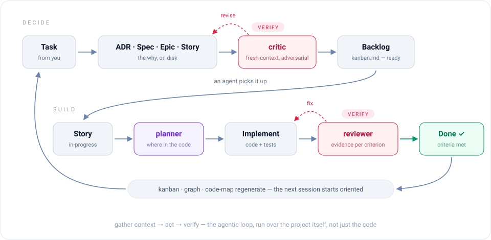
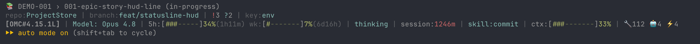
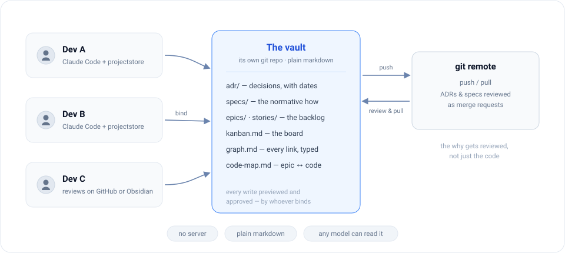

# ProjectStore

> Not agent memory, not a per-feature spec pipeline. Memory helps one agent recall; a feature spec plans one change. ProjectStore keeps the project's record — what was decided, what is in flight, what was checked — as reviewed markdown in git, readable by any agent and anyone with the repo.

[](https://github.com/SmartAndPoint/ProjectStore/releases) [](./LICENSE) [](https://github.com/SmartAndPoint/ProjectStore/stargazers)

A project workflow plugin for [Claude Code](https://claude.com/claude-code) and [OpenAI Codex](https://developers.openai.com/codex/) (experimental). Both are released together at one version, and one command sets a project up for either or both: see [Install](#install).

---

## Two months of agents, and nobody knows why

Agents write code fast. They re-decide settled questions even faster: every fresh session arrives empty, makes its own architectural call, and commits under its own assumptions. Two months later you have noodle code — every strand reviews fine on its own, and each was written under a different theory of the project. Ask *"why is this a queue and not a cron job?"* and nobody can answer. The agent that decided is long gone.

The fix is not a smarter agent. It is a loop with verification in it.

## Where it fits

**Not agent memory. Not a spec pipeline. The project's record.** Three kinds of tools sit next to a coding agent. Each answers a different question.

| Kind of tool | The question it answers | What it keeps | Examples |
|---|---|---|---|
| **Agent memory** | What does this agent recall? | Notes the model keeps from its sessions, for an agent, a user or a machine. | Mem0, Zep, Codex and Claude Code memory |
| **Instruction files** | How should an agent behave here? | Standing rules for an agent, kept in the repository. | `CLAUDE.md`, `AGENTS.md`, rules, steering files |
| **Spec-driven tools** | How do we build this change? | A spec, a plan and tasks for one feature. | Spec Kit, Kiro, OpenSpec, BMAD |
| **ProjectStore** | What has the project decided, what is in flight, and was it checked? | Decisions, specs and work items with a status, a date and links, in git. A person approves each before ProjectStore writes it; a fresh-context critic reviews it by rule. | — |

Keep your agent's memory for you and your machine, and the project in the vault.

Decision logs, validators, session-start orientation and independent review each exist elsewhere. What ProjectStore adds is all of them over one linked record. Tool by tool, with sources: [`docs/alongside.md`](./docs/alongside.md).

## The loop

The thing that makes agentic coding work — the loop Claude Code's own creator keeps pointing at — is *gather context, act, verify, repeat*. ProjectStore runs that loop one level up: over the project, not just the code.

<picture>
  <source media="(prefers-color-scheme: dark)" srcset="docs/images/loop.svg">
  
</picture>

1. **You hand the agent a task.** It opens an artifact before it opens an editor: an ADR if something needs deciding, an epic and stories for the work, a spec when the "how" is non-trivial.
2. **A fresh-context critic attacks the artifact.** Expect *revise* — on this repo it has yet to pass anything on the first try, and that is the point.
3. The fixed artifact lands in the **backlog**; the kanban regenerates itself.
4. An agent picks up a story. A **planner** reads how earlier epics actually landed in the code and says where this change belongs.
5. By rule, a **reviewer** matches the diff against the story's acceptance criteria — per criterion, with evidence — before anything gets called done.
6. **Done.** Board, link graph and code map regenerate. The next session starts oriented instead of guessing.

Mechanisms hold this together, not discipline: an agent that starts coding with no story open gets nudged; an artifact that needs review carries `review_status: pending` until a critic pass is applied, so "not yet reviewed" is a state the tools can read rather than something someone must remember; and a deterministic `doctor` checks the mechanical consistency with zero AI involved. Every *verify* step is a separate fresh-context agent with no stake in the draft it is judging.

We build ProjectStore with ProjectStore. The feature that names your session went through exactly this loop — including a critic pass that killed the design's central claim, and a reviewer pass that caught a bug which would have shipped the feature silently dead for every real user.

## What lands on disk

Say *"let's go with Postgres, not Mongo — we need transactions"*, approve the draft, and a real file lands:

```markdown
---
title: "Use Postgres for primary storage"
status: accepted
date: 2026-07-03
---
## Context
We need ACID transactions for order processing...
## Decision
Postgres 16 as the primary store...
## Alternatives Considered
### MongoDB — rejected because...
```

Six months later, *"why Postgres?"* has an answer with a date and the alternatives you rejected. Stories work the same way — status in frontmatter, board generated from it — and your status line always shows what *this* session is working on:



In Claude Code a band above the prompt goes further (experimental): the session's epic with its goal and how far it is, the story in hand, and the ProjectStore agent at work — `critic · opus 5.5 · reviews «…»` — on the model its own requests name. While it draws, the status line steps aside; `/projectstore:bar off` hides it, `/projectstore:bar status` says why it is not there.

Open the vault in [Obsidian](https://obsidian.md) and you get the graph view and the board for free. Don't use Obsidian? Everything renders on GitHub and in any editor.

## Install

From a terminal in your project:

```
npx projectstore setup
```

Setup finds the coding agents the project uses — Claude Code, Codex or both — and installs ProjectStore for each, with a vault for the project's notes. At a terminal it asks a few questions: which folder is the project, which agents to install for, where the vault lives (an existing folder is bound; a missing or empty one becomes a new vault, with its own git repository and the layout's folders) and whether to show ProjectStore in the status line. Then it prints one plan — every file it writes and every host command, verbatim — and asks once before it writes anything. Restart the agent afterwards; Codex asks you to approve the ProjectStore hooks once.

**What it needs:**

- Node.js 20 or later, always. The plugin's hooks, its MCP server and the status line run as `node` inside the agent session.
- npm, for Codex only: setup fetches the Codex plugin through npm. Claude Code alone needs no npm.
- The agent's own CLI on PATH (`claude`, `codex`), and git for a new vault.
- A terminal outside every Claude Code and Codex session: inside one, the registration waits and the plan says so.
- macOS or Linux. Windows is not verified yet.

Other package runners start setup the same way. Each was observed running it with Claude Code and Codex:

```
bunx projectstore@latest setup
```

```
pnpm dlx projectstore@latest setup
```

```
deno run -A npm:projectstore@latest setup
```

`pnpm dlx` needs pnpm 6.13 or later. Without npm on PATH, a runner sets up Claude Code and refuses Codex, naming npm. The runner only fetches the package: setup copies the plugin into the agents' own directories, so clearing the runner's cache later breaks nothing.

`npx projectstore setup --dry-run` shows the questions and the plan and writes nothing. Without a terminal (a script, CI, an agent's tool) nothing is asked: `--harness <id>` names an agent and is the confirmation, and `--vault <path>` names the vault. `npx projectstore setup --help` lists the rest.

If you prefer a global command:

```
npm install -g projectstore
projectstore setup
```

Behind a registry mirror (often a company's), `npx` runs the newest `projectstore` the mirror knows. That can be a release older than setup, which answers that `setup` is an unknown verb, or no release at all. Name the version, and if that is not enough, the public registry:

```
npm_config_registry=https://registry.npmjs.org npx projectstore@<version> setup
```

npm reads that variable wherever it runs, so the Codex plugin setup fetches comes from the same registry.

### In a Claude Code session

Open Claude Code in your project and say:

> Install the projectstore plugin from https://github.com/SmartAndPoint/ProjectStore and set it up for this project.

Claude adds the git marketplace, installs the plugin, and walks you through binding a vault, scaffolding it and wiring the status line — every step previewed, nothing written without your Yes. Or type it yourself:

```
/plugin marketplace add SmartAndPoint/ProjectStore
/plugin install projectstore@SmartAndPoint
/reload-plugins
/projectstore:bind ~/Documents/my-project-vault
```

One switch worth flipping: Claude Code does **not** auto-update third-party plugins by default — `/plugin` → **Marketplaces** → **SmartAndPoint** → toggle **auto-update** on. If you skip it, `/projectstore:doctor` will remind you later with the exact setting.

Contributors: `git clone` this repo, then run Claude Code from the clone's parent folder:

```
claude --plugin-dir ./ProjectStore
```

<details>
<summary>What setup does for each agent, the low-level verbs, the CLI and MCP</summary>

**Claude Code.** Setup registers the plugin from the npm package [`projectstore`](https://www.npmjs.com/package/projectstore) — one source package carrying every harness's manifest. It writes a small local marketplace of its own under your Claude home, then drives `claude plugin marketplace add` / `plugin install` **at local scope**, so the registration lands in this checkout's `.claude/settings.local.json` and nowhere else. The host CLI and a live session both rewrite the same settings files, so inside a Claude Code session the registration is deferred, and the plan says so: run setup from a terminal outside the session. When the checkout already loads ProjectStore from the git marketplace, setup asks whether to switch this project to the npm install or keep the git marketplace. A switch silences the git-marketplace copy for this checkout only (not globally), so the plugin does not load twice; `uninstall` turns it back on.

**Codex.** The Codex plugin ships in a package of its own; setup fetches it at setup's own version and plans Codex in the same plan as everything else. It stages a stable marketplace under `CODEX_HOME`, drives `codex plugin marketplace add` and `codex plugin add`, then reads the installation back and verifies its version and payload digest. Before it changes anything it asks Codex for that read-back (`codex plugin list --json`), so a Codex too old to answer stops the registration before it changes anything and tells you to upgrade Codex. Codex's plugin registry is user-global; the agents block in `AGENTS.md` stays project-local. Codex is **experimental** until a live session has exercised every surface it installs: [`docs/harnesses.md`](./docs/harnesses.md#codex) says what has been verified and what has not. A project can be worked from both agents: they share the binding in `.projectstore/`, and each keeps its own overlay and session state beside it ([running both over one project](./docs/harnesses.md#running-both-over-one-project)).

**The low-level verbs.** Setup composes verbs that also run on their own. One agent's install, with no questions about the project or the vault:

```
npx projectstore install --harness claude-code   # shows the plan, asks at a terminal, then writes; without a terminal naming the harness is the confirmation — there is no --yes
```

`plan` prints the same plan and writes nothing; `--verbose` adds every row's reasoning; `npx projectstore <verb> --help` lists a verb's options with examples. bun works the same on the packed bin.

Without a session — in CI, or in a shell — the same core answers token-free, with a `--json` envelope on every verb:

```
npx projectstore doctor --json
npx projectstore reconcile --write --only kanban
```

At a terminal the bin's output is coloured; a pipe gets the same layout as plain text. `NO_COLOR=1` turns the colour off, and `PROJECTSTORE_ASCII=1` draws every glyph in ASCII — for a terminal that draws ambiguous-width characters wide (`TERM=dumb` does both).

Reads too — the same facts the agents get over MCP:

```
npx projectstore status --json
npx projectstore search "entry rule" --kind spec
npx projectstore show adr/README.md --section index
npx projectstore graph neighbors epics/PS-CORE/epic.md
npx projectstore codemap --for scripts/lib.mjs
```

The same eight reads are an MCP server. The plugin registers it through its own `.mcp.json`, so a Claude Code session has `status`, `search`, `get_artifact`, `neighbors`, `lineage`, `code_refs`, `orientation` and `doctor` as tools with no shell; every tool result is the CLI's `--json` for the same arguments. Elsewhere:

```
npx projectstore mcp --project "$PWD"
```

Binding, too — naming the vault is the confirmation, and changing it needs `--rebind`. `init` creates a whole vault in one step, with no `mkdir` first: the directory, its git repository, the layout's folders and their README indexes; `scaffold --write` adds the folders to a vault that was bound without them:

```
npx projectstore bind ~/vaults/my-project
npx projectstore init ~/vaults/new-project --language ru
npx projectstore scaffold --write
```

`projectstore-claude`, `projectstore-codex` and `projectstore-opencode` are release artifacts: per-harness packages that carry the core, pinned at the same version and bundled, with the harness fixed. Nobody needs to type their names. Setup fetches the Codex one, which carries the Codex plugin; the Claude Code one is published at the core's version too; the opencode one publishes after its plugin root is rendered. The other `projectstore-*` names are reserved placeholders pointing back here. One source package, one version, N tarballs. How a release builds and publishes them, and how to run a checkout's own build: [`packaging/README.md`](./packaging/README.md).
</details>

## Configure

Setup asks only what a first install needs. Everything after it is one command, from a terminal in your project:

```
npx projectstore configure
```

At a terminal it opens a settings menu that works like a monitor's: ↑ and ↓ move, → opens a group or a setting in a frame beside it, space chooses, ← goes back, and Enter shows the plan. A second Enter writes it. Under the frames, a few lines say what the row under the cursor means. The settings:

- each agent's model and effort, per harness. Claude Code offers its aliases: `fable`, `opus`, `sonnet` and `haiku`. Codex offers its own list of models, with its descriptions. With `ANTHROPIC_API_KEY` set, each alias also names the newest model of its line. A list is kept for a day in projectstore's user cache, and "refresh the list" asks again. Each agent's effort sits under its model: Claude Code's levels, `low` to `max`, or the levels that Codex model lists. With none set, a Claude Code agent runs at its frontmatter's level (`max`, the clerk `low`) and a Codex one at its model's own default;
- the status line and the band above the prompt (Claude Code);
- the vault's template language, the default author and tags;
- the vault's spec policy and lifecycle gates.

Without a terminal it prints every setting with its current value and where it lives, and writes nothing. To change a setting there, name it with `--set`; naming it is the confirmation:

```
npx projectstore configure --set agents.critic=fable --set statusline=on
```

An agent's effort is its own key: `--set agents.critic.effort=xhigh`. `--dry-run` shows the plan and writes nothing, and `--json` returns the settings as one envelope. In a project that uses two harnesses, an agent's model or effort names its overlay with `--harness <id>`.

Each setting has exactly one writer, and the plan says which file it changes:

- **The agents' models and efforts** live in `.projectstore/harness/<harness>.json`. That file is committed, so a change there is a team change.
- **The status line, the band, the language and the other binding keys** live in `.projectstore/projectstore.json`, which stays on this machine.
- **The spec policy and the lifecycle gates** live in the vault's `.projectstore.json`, which commits with the vault. Setting `spec_policy=required` records when it took effect; stories closed before then are exempt.

The vault itself is changed by `bind --rebind`, which configure names when asked. In a Claude Code session, `/projectstore:statusline` and `/projectstore:agents configure` run the same writers.

## Upgrading

Installed with setup or from npm: from a terminal in your project, name the version you want to run (`latest` is the newest):

```
npx projectstore@<version> upgrade
```

It upgrades every agent the project uses — each one whose own directory (`.claude/`, `.codex/`) or `.projectstore/state/<id>/` is there — in one plan, and fetches the Codex plugin at the same version. `npx projectstore setup` converges a project the same way and asks its questions again. Installed from the git marketplace in a Claude Code session: `/plugin update` (or auto-update) and a restart.

A bare upgrade selects agents by those directories, so on Codex name it, which upgrades Codex even in a project where no Codex session has run yet:

```
npx projectstore@<version> upgrade --harness codex
```

With the global command, update it first, then run it in the project:

```
npm install -g projectstore@latest
projectstore upgrade
```

A project bound before 0.28 needs one more command. What an existing project sees afterwards, and why:

- **The project's files move to `.projectstore/`.** `.claude/projectstore.json`
  and `.claude/.projectstore/` become `.projectstore/projectstore.json`,
  `.projectstore/harness/claude-code.json` and `.projectstore/state/`. Nothing
  breaks before you move them: every reader falls back to the old paths through
  0.30, and the startup line names the command until the move is done. Close
  every Claude Code session in the project, run that command from a terminal in
  the project, then restart. The command depends on how you installed. From the
  git marketplace (every 0.27.x install), it is the installed copy's own
  `bin/projectstore.mjs`, with its path spelled out in the startup line:

  ```
  node "<plugin cache>/bin/projectstore.mjs" upgrade --harness claude-code --no-register
  ```

  From npm:

  ```
  npx projectstore@<version> upgrade --harness claude-code --no-register
  ```

  `--no-register` leaves your plugin registration as it is: both forms move
  only the project's files. The same run re-stamps the status-line launcher at
  its new path and re-registers the agents block, whose template is now v4. An
  upgrade without `--no-register` on a git-marketplace install does more: it
  also registers the plugin from npm for this checkout and turns the
  git-marketplace copy off here, so `/plugin update` stops reaching the
  checkout. The 0.28.0-rc.1 and rc.2 startup lines named that form, without
  `--no-register`, so on those, update first and run what the new startup line
  names. If it already happened, this turns the git-marketplace copy back on
  (0.28.0 or later), from a terminal in the project:

  ```
  npx projectstore@<version> uninstall --harness claude-code --surface plugin
  ```

  That copy must be 0.28 or later — an older one reads a moved project as
  unbound — so update it first if it is not. Restart, then in the new session,
  to re-stamp the status line against that copy:

  ```
  /projectstore:doctor --fix
  ```
- **The status line keeps rendering.** A launcher written by an earlier version
  still works, but it carries no file stamp and its embedded fallback root is
  frozen at the old version; the move above re-stamps it. Nothing rewrites that
  file behind your back any more: first wiring and refresh are `install`'s,
  behind a preview.
- **`/projectstore:status` and `/projectstore:search` answer differently:**
  facts from artifact frontmatter and the derived views' freshness instead
  of an `mtime` walk; a literal, bounded, grouped search instead of a shell
  `grep`. Every other command prints what it printed before.
- **`/projectstore:doctor` has new lines** — the state of each installed
  surface, a version-drift check across plugin versions, and one permanent
  info line saying the MCP read tools are registered. Its exit code now
  carries the verdict (1 = findings), so a red Bash result is findings, not
  a crash.
- **The plugin registers an MCP server** (eight read-only tools over the
  vault). Claude Code may ask you to approve it once.
- **The agents block stays where Claude Code reads it.** In a project with an
  `AGENTS.md`, the block goes there and `CLAUDE.md` carries a one-line
  `@AGENTS.md` import; otherwise the block goes into `CLAUDE.md`. A project with
  an `AGENTS.md` and no `CLAUDE.md` now gains that one-line `CLAUDE.md`.
- **The passive skills are published under the `projectstore-` prefix**
  (`projectstore-decision-detector`, `projectstore-peer-reviewer`,
  `projectstore-story-completion`, `projectstore-vault-communication`). Nothing
  in a project names them; only a skill listing shows the new names.
- **Rolling back** to 0.27.x before the move: everything keeps working, since
  0.27.x still reads the old layout. It rewrites the status-line launcher in its
  own form, as it always did; coming forward again, the startup line names the
  move once more, and the move re-stamps the launcher. If a session already
  re-stamped the status line or re-registered the agents block before the move
  (rc.2's `/projectstore:doctor --fix` did both), 0.27.x reports a foreign
  status line and a v4 block and leaves both alone — unless you run
  `/projectstore:agents register` in it, which rewrites the block; the status
  line still renders, and the move settles both.
- **Rolling back** to 0.27.x after the move: 0.27.x looks for its binding under
  `.claude/`, finds none and offers `bind`. Do not accept. A re-bind writes
  `.claude/projectstore.json` again, and 0.28's `install` and `upgrade` refuse
  while two bindings exist. To come forward again, delete
  `.claude/projectstore.json`, then run the command the startup line names
  once more: a 0.27.x session writes its welcome marker back under `.claude/`.
- **Installed from npm?** Then `/plugin update` has nothing to fetch: the
  package itself refreshes the registration. The upgrade at the top of this
  section, run from a terminal outside the session, rewrites the local
  marketplace and runs the host's `plugin update` for this checkout.
  `/projectstore:doctor` says when the registration is behind the package, and
  names the command.

## When an agent starts a task, it can find its way

Two generated views exist for exactly that moment. `graph.md` holds every artifact's links, typed, in both directions — one grep returns a document's whole neighborhood. `code-map.md` answers where the code for each epic actually lives, so new code lands where the old code already is. And before any architectural choice, the agent is pointed at the ADR index first — which is how settled questions stay settled.

## Teams: many humans, many agents

<picture>
  <source media="(prefers-color-scheme: dark)" srcset="docs/images/team.svg">
  
</picture>

Put the vault in its own repository. Every teammate installs ProjectStore, binds to the same vault, and contributes through the same approval gates. ADRs and specs get reviewed like code — as merge requests, except what's under review is the *reasoning*. A teammate without an agent reviews on GitHub or in Obsidian: it is all just markdown.

Parallel sessions coordinate too: each registers itself, sessions warn each other on the same vault, every status line shows only its own work — and once a session's writing settles on an epic or a document, it gets offered a name to be addressed by. Measured before shipping: roughly one offer per session; the naive "rename on every change" fired 37 times in the worst recorded session, which is why it doesn't do that.

## What it costs — measured, not promised

Running the loop is not free, and we will not pretend otherwise. On this very repository — the worst case we know, since here the tool builds itself and every change goes through the full loop — vault work measures **22.5% of total spend**. On a typical project, budget **10–15% of your weekly limit**.

What you get for it: a project manager and a systems analyst who never forget to file, made of the same agent you already pay for. The artifacts are not notes-to-self — they are the working backlog, the review record and the decision log of the project.

And they are the exit door. The vault is plain markdown in git — no server, no proprietary format, nothing to export. Move to Codex, Gemini or DeepSeek tomorrow and the project continues: the orientation a new agent needs is already on disk, so you spend no tokens re-teaching a model what the project is and why.

## Fact sheet

**21 commands** · **6 agents** — critic, planner, reviewer, librarian, archaeologist (the advisors: read-only, fresh-context) and clerk (the sole write-capable one — it executes approved writes, post-gate, and composes nothing) · **6 languages** — en, ru, es, de, fr, zh · zero runtime dependencies

The deep dive — real session files, measured payloads, how every mechanism works and where its limits are: [docs/how-it-works.md](./docs/how-it-works.md).

## Philosophy

1. **Markdown + git is the source of truth.** No proprietary format. The plugin can disappear; your project's decisions remain.
2. **Obsidian is a view, not a dependency.** Files render on GitHub, in any editor, in `cat`.
3. **The agent is a methodologist, not a database.** Skills nudge, commands gate, humans approve.
4. **Layouts are opinionated.** v1 ships `engineering`; community adds `data-analytics`, `product`, `chatbot`, `library`.
5. **One brain per project, not per person.** The vault travels with the repo. Karpathy's [LLM Wiki](https://gist.github.com/karpathy/442a6bf555914893e9891c11519de94f) is its personal-research counterpart.

## Uninstalling

From a terminal in your project:

```
npx projectstore uninstall
```

With no `--harness` it covers every agent the project uses — each one whose own directory (`.claude/`, `.codex/`) or `.projectstore/state/<id>/` is there — and removes what install wrote, and only that. For Codex that is the project-owned wiring: its plugin and marketplace are user-global, and removing them for every project is explicit:

```
npx projectstore uninstall --harness codex --global
```

A Claude Code install from the git marketplace is removed in the session:

```
/plugin uninstall projectstore@SmartAndPoint
```

**What a removal keeps:**

- the vault;
- the binding `.projectstore/projectstore.json`, with the status-line choice, so a later setup wires the line again;
- the agents' models in `.projectstore/harness/`, which is committed team configuration;
- Codex's user-wide registration, until `--global` removes it.

`--global` removes the Codex plugin for every other project on this machine too. Their `AGENTS.md` blocks stay and name agents that no longer load: uninstall Codex in each of them as well, or set them up again.

Your vault is yours — plain markdown, untouched. One leftover of a host-managed plugin path can be the agents block in `CLAUDE.md`/`AGENTS.md`; remove it with the harness's agents unregister skill, or delete everything between `<!-- projectstore:agents … -->` and `<!-- /projectstore:agents -->` by hand. A one-harness `uninstall`, with `--harness <id>`, leaves a block that lives in `AGENTS.md`, because that file is read by other coding agents too. Claude Code's then removes the `CLAUDE.md` import when that file holds nothing else; Codex's keeps it, so Claude Code still sees the block. `uninstall --surface agents_block` removes the block as well. Once every harness that can read the block's file is among those uninstalled (for `AGENTS.md`, Claude Code and Codex), the block goes too, and the `CLAUDE.md` import with it unless your own text keeps both files.

### Reinstalling clean

Keeping the vault and the binding, uninstall and set up again. The second setup finds both:

```
npx projectstore uninstall
```

```
npx projectstore setup
```

To start as if the project was never bound, remove only the machine-local half after the uninstall. `.projectstore/harness/` and `.projectstore/.gitignore` are committed; keep them. The binding also carries the template language, the default author and tags, the skills switch, the band and the status-line choice, and removing it drops them. Setup then asks for the vault again.

```
rm -f .projectstore/projectstore.json
```

```
rm -rf .projectstore/state
```

To point the project at another vault, no reinstall is needed. From a terminal in your project:

```
npx projectstore bind ~/vaults/other --rebind
```

## Extending

See [`docs/extending.md`](./docs/extending.md) for adding layouts, templates, and skills, and [`docs/harnesses.md`](./docs/harnesses.md) for which coding agents projectstore runs on — what "experimental" means there, and what adding one takes.

## Contributing

Issues and discussions: https://github.com/SmartAndPoint/ProjectStore/issues. PRs welcome — adding a layout is a good first contribution (see `scaffold/layouts/engineering.json` for the format).

The published package has no dependencies. The linter and the formatter are dev-only and live in a package of their own, `tools/lint/`, pinned in its `package-lock.json`. The repository root has no lockfile, because Claude Code installs whatever a lockfile at a plugin's root names into every user's copy. Every pull request runs the tests, ESLint and Prettier:

```sh
npm test              # Node 20+, no install needed
npm run lint:setup    # once per checkout, for the lint tools (Node 20.19+, 22.13+ or 24+)
npm run lint
npm run format        # rewrites; npm run format:check only reports
```

Editors find the config at the root; point their tool path at the pinned copies — in VS Code, `"eslint.nodePath": "tools/lint/node_modules"` and `"prettier.prettierPath": "tools/lint/node_modules/prettier"`.

One formatting-only commit is listed in `.git-blame-ignore-revs`. GitHub skips it in blame by itself; a local clone needs this once:

```sh
git config blame.ignoreRevsFile .git-blame-ignore-revs
```

A branch opened before that commit rebases in two steps, so that the lint fixes before it are kept. First onto the commit before it, resolving real conflicts as usual:

```sh
git rebase <the commit before it>
```

Then onto the formatting commit itself, where every conflict is formatting only: take your side, format the file with `npm run format` and `git add` it, then continue.

```sh
git rebase --onto <it> <the commit before it>
```

## License

MIT — see [`LICENSE`](./LICENSE).
